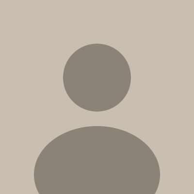
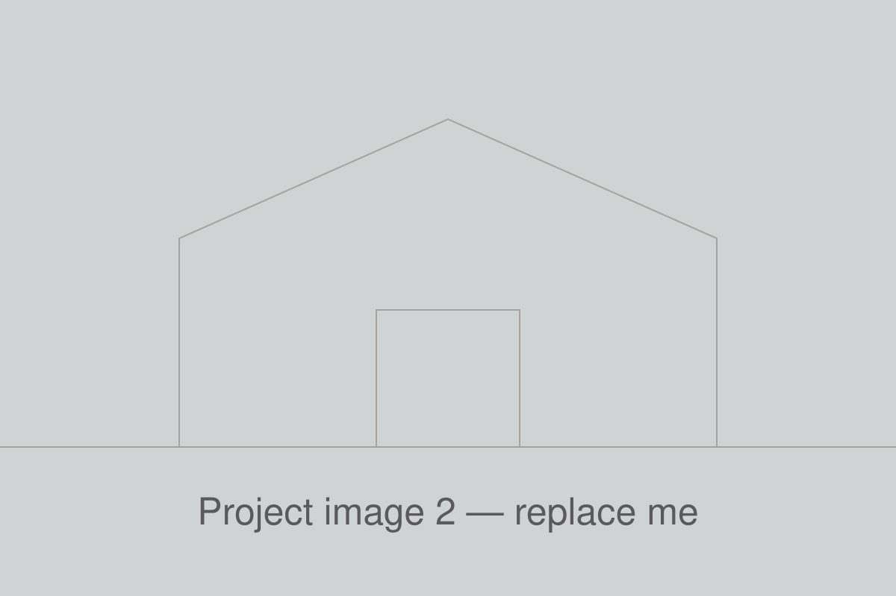
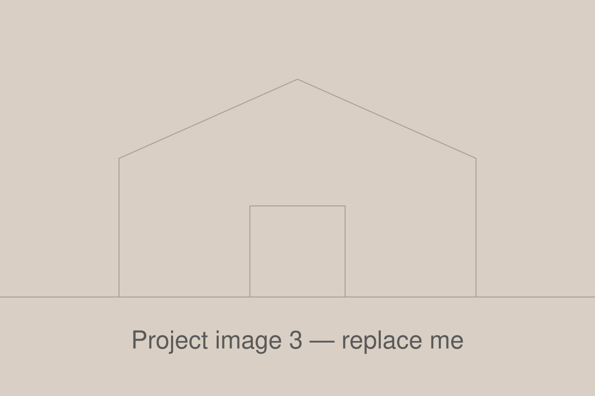
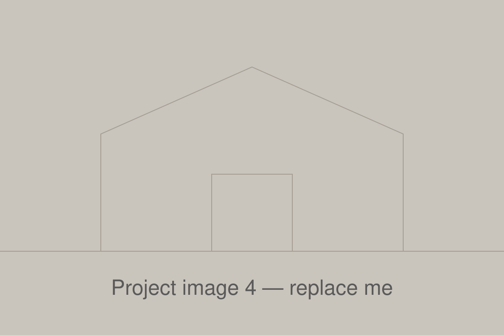

<!-- =====================================================================
     EDITING GUIDE
     - Replace every [PLACEHOLDER] / sample text below with Khalid's content.
     - Profile photo:     assets/images/profile/headshot.jpg
     - CV / resume PDF:   assets/docs/profile/Elsadany-CV.pdf
     - Project images:    assets/images/projects/<project-name>/...
     - Gallery images:    assets/gallery/...  (then list them in galleryImages at the bottom)
     ===================================================================== -->

<!-- Hamburger Menu -->
<button class="hamburger-menu" id="hamburgerBtn">
  ☰
</button>

  <!-- Sidebar -->
  <aside class="sidebar" id="sidebar">
    

      
      <h1 class="profile-name">Khalid Elsadany</h1>
      
Architect

      
[Firm / Studio] | [City, Country]

    

    

      <a href="mailto:[email@example.com]" class="contact-link">
        [email@example.com]
      </a>
      <a href="https://www.linkedin.com/in/[linkedin-handle]/" class="contact-link" target="_blank">
        LinkedIn Profile
      </a>
      <a href="https://www.instagram.com/[instagram-handle]/" class="contact-link" target="_blank">
        Instagram
      </a>
      <a href="https://www.behance.net/[behance-handle]" class="contact-link" target="_blank">
        Behance
      </a>
      <a href="assets/docs/profile/Elsadany-CV.pdf" class="contact-link">
        CV (PDF)
      </a>
    

    <nav class="nav-menu">
      <h3 class="nav-title">Navigation</h3>
      <ul class="nav-list">
        <li class="nav-item"><a href="#about" class="nav-link">01About</a></li>
        <li class="nav-item"><a href="#expertise" class="nav-link">02Expertise</a></li>
        <li class="nav-item"><a href="#projects" class="nav-link">03Projects</a></li>
        <li class="nav-item"><a href="#recognition" class="nav-link">04Recognition</a></li>
        <li class="nav-item"><a href="#gallery" class="nav-link">05Gallery</a></li>
        <li class="nav-item"><a href="#contact" class="nav-link">06Contact</a></li>
      </ul>
    </nav>

    

      Theme
      <label class="theme-toggle">
        <input type="checkbox" class="theme-checkbox" id="themeToggle">
        
      </label>
    

  </aside>

  <!-- Main Content -->
  <main class="main-content">
    

      <!-- Hero Statement -->
      

        <h2>[One-line design philosophy, e.g. "Designing spaces that respond to people, place, and light"]</h2>
        
[Two-sentence intro: who Khalid is, the type of work he does (residential, cultural, urban, interiors...), and where he trained/practices.]

      

      

        <a href="assets/docs/profile/Elsadany-CV.pdf" class="link-button" target="_blank">↓ Download CV (PDF)</a>
      

      <!-- About Section -->
      <section id="about" class="section">
        

          
01

          <h2>About Me</h2>
        

        
<strong>My approach:</strong> [What drives his design thinking — context, materiality, sustainability, community, craft, etc.]

        
[Background: education (e.g. B.Arch / M.Arch, university), years of experience, project types and scales he has worked on.]

        

          <strong>Currently:</strong>
          <ul>
            <li>[Role] at [Firm / Studio]</li>
            <li>[What he is working on now — e.g. leading design development for a mixed-use project]</li>
            <li>[Licensure / certifications — e.g. Registered Architect, LEED AP]</li>
          </ul>
        

      </section>

      <!-- Expertise Section -->
      <section id="expertise" class="section">
        

          
02

          <h2>Expertise & Tools</h2>
        

        
[Short sentence summarizing his range — from concept design through construction documentation.]

        

          

            <h3>Architectural Design</h3>
            
Concept development, massing studies, space planning, design development

            
Sketching · physical models · design reviews

          

          

            <h3>BIM & Documentation</h3>
            
Construction documents, detailing, coordination with consultants

            
Revit · AutoCAD · ArchiCAD

          

          

            <h3>3D Modeling</h3>
            
Parametric and form-finding studies, digital fabrication

            
Rhino · Grasshopper · SketchUp

          

          

            <h3>Visualization</h3>
            
Photorealistic renderings, walkthrough animations, presentation boards

            
Enscape · Lumion · V-Ray · Twinmotion

          

          

            <h3>Graphic Design</h3>
            
Diagrams, portfolio layouts, competition boards

            
Photoshop · Illustrator · InDesign

          

          

            <h3>Sustainability</h3>
            
Passive design strategies, daylight and energy analysis

            
Ladybug · Climate Studio · LEED

          

        

      </section>

      <!-- Projects Section (copy a 
 block for each new project) -->
      <section id="projects" class="section">
        

          
03

          <h2>Selected Projects</h2>
        

        

          <h3>[Project Name 1 — e.g. Courtyard House]</h3>
          

            <strong>Type:</strong> [Residential]
            <strong>Location:</strong> [City]
            <strong>Year:</strong> [2025]
            <strong>Role:</strong> [Lead Designer]
            <strong>Status:</strong> [Built / Competition / Academic]
          

          
          
<strong>Concept:</strong> [The core idea of the project in one or two sentences.]

          <ul>
            <li>[Key design move #1]</li>
            <li>[Key design move #2 — materials, structure, sustainability, etc.]</li>
            <li>[Outcome — client, award, built area]</li>
          </ul>
          

            
            
            
          

          

            <strong>Tools:</strong> Revit · Rhino · Enscape · Photoshop
          

        

        

          <h3>[Project Name 2 — e.g. Community Library]</h3>
          

            <strong>Type:</strong> [Cultural]
            <strong>Location:</strong> [City]
            <strong>Year:</strong> [2024]
            <strong>Role:</strong> [Project Architect]
            <strong>Status:</strong> [Under Construction]
          

          
          
<strong>Concept:</strong> [The core idea of the project.]

          <ul>
            <li>[Key design move #1]</li>
            <li>[Key design move #2]</li>
          </ul>
          

            <strong>Tools:</strong> AutoCAD · SketchUp · Lumion
          

        

        

          <h3>[Project Name 3 — e.g. Urban Waterfront Master Plan]</h3>
          

            <strong>Type:</strong> [Urban Design]
            <strong>Location:</strong> [City]
            <strong>Year:</strong> [2023]
            <strong>Role:</strong> [Team Member]
            <strong>Status:</strong> [Competition Entry]
          

          
          
<strong>Concept:</strong> [The core idea of the project.]

          <ul>
            <li>[Key design move #1]</li>
            <li>[Key design move #2]</li>
          </ul>
          

            <strong>Tools:</strong> Rhino · Grasshopper · Illustrator
          

        

      </section>

      <!-- Recognition Section (awards, competitions, exhibitions, publications) -->
      <section id="recognition" class="section">
        

          
04

          <h2>Awards, Competitions & Exhibitions</h2>
        

        

          <h3>[Award / Competition Name]
            <a href="#">[View Board →]</a>
          </h3>
          
<strong>[Organizer], [Year]</strong> | [Winner / Shortlisted / Honorable Mention]

          
          
[Short description of the entry and what made it stand out.]

          

            <strong>Themes:</strong> [Adaptive reuse · Public space · Housing]
          

        

        

          <h3>[Exhibition / Publication Name]</h3>
          
<strong>[Venue / Publication], [Year]</strong> | [Exhibited / Published]

          
[Short description.]

        

      </section>

      <!-- Gallery Section (images listed in galleryImages at the bottom of this file) -->
      <section id="gallery" class="section">
        

          
05

          <h2>Gallery</h2>
        

        
Renders, sketches, models, and drawings. Click any image to view it full size.

        

        

          <!-- Gallery populated by JavaScript -->
        

        
Loading...

        

          <button id="show-more-btn" class="gallery-btn">Show More</button>
          <button id="show-less-btn" class="gallery-btn" style="display: none;">Show Less</button>
        

      </section>

      <!-- Contact & Links Section -->
      <section id="contact" class="section">
        

          
06

          <h2>Contact & Links</h2>
        

        
[Short invitation — e.g. "Open to collaborations, commissions, and new opportunities."]

        

          

            <h3>Email</h3>
            
Get in touch about projects or collaborations

            <a href="mailto:[email@example.com]" class="link-button">Send Email</a>
          

          

            <h3>LinkedIn</h3>
            
Professional experience and updates

            <a href="https://www.linkedin.com/in/[linkedin-handle]/" class="link-button" target="_blank">Connect</a>
          

          

            <h3>Instagram</h3>
            
Sketches, site visits, and work in progress

            <a href="https://www.instagram.com/[instagram-handle]/" class="link-button" target="_blank">Follow</a>
          

          

            <h3>Behance / Issuu</h3>
            
Full portfolio booklet and presentation boards

            <a href="https://www.behance.net/[behance-handle]" class="link-button" target="_blank">View Portfolio</a>
          

        

      </section>

    

  </main>

<!-- Lightbox -->

  &times;
  

    <button onclick="changeImage(-1)">&#10094;</button>
    <button onclick="changeImage(1)">&#10095;</button>
  

  

<!-- Footer -->
<footer>
  
&copy; 2026 Khalid Elsadany. Last updated: October 2026.

</footer>

